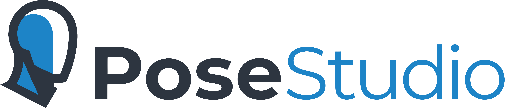
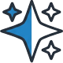
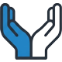
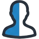
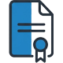

<a href="https://discord.gg/SaKvt9aYCM"></a>
<!-- ALL-CONTRIBUTORS-BADGE:START - Do not remove or modify this section -->
[](#contributors-)
<!-- ALL-CONTRIBUTORS-BADGE:END -->


**Welcome to the PoseStudio Open-Source Project**.

Our mission is to build a robust, community-driven platform for 3D character creation and scene production.

PoseStudio is an open-source project designed to support the full workflow of creating and customizing 3D characters, posing and animating them, and building complete scenes for rendering. It combines modern character creation tools, animation systems, and AI-assisted workflows into a unified environment. 

The goal is to reduce reliance on fragmented toolchains and provide a flexible, open ecosystem for 3D artists, content creators, and developers.

## 📥 Download & Try It

[](https://github.com/PoseStudio/PoseStudio/releases/latest) [](https://github.com/PoseStudio/PoseStudio/releases)

PoseStudio is in early development, and we'd love for you to **try it and tell us what you think**. No build tools needed:

1. **[Download the latest release](https://github.com/PoseStudio/PoseStudio/releases/latest)** — grab `PoseStudio-<version>-Windows-Setup.exe` under *Assets*.
2. **Run the installer.** If Windows shows a *"Windows protected your PC"* warning, click **More info → Run anyway** — that's expected for a young open-source project without a paid code-signing certificate; every build is compiled in public by [GitHub Actions](https://github.com/PoseStudio/PoseStudio/actions) straight from this repository.
3. **Launch PoseStudio** from the Start Menu, import a figure, and start posing.

Needs 64-bit Windows 10/11 and a Vulkan-capable GPU (virtually any graphics card from 2016 onward). A portable no-install zip is also available on the release page. **Full instructions and troubleshooting: [Installation Guide](docs/INSTALL.md)**. macOS and Linux builds are planned.

**Privacy:** each time it starts, the app sends a small anonymous ping to posestudio.io — a random install ID, the version, your OS and CPU type, whether it was installed or runs portable, the Qt version it was built with, and the time of the ping — so we can count active installs and see which versions are in use. No names, no files, no usage data. You can switch it off in Edit → Preferences → General; details in the [Installation Guide](docs/INSTALL.md#privacy--the-install-ping).

Tried it? **[Tell us what was confusing or delightful](https://github.com/PoseStudio/PoseStudio/issues/new?template=usability_feedback.yml)** — usability feedback is exactly what this early release is for — or join the conversation on [Discord](https://discord.gg/SaKvt9aYCM).

##  Get Involved

We are calling on anyone who can help with the project. Your support ensures that the future of character creation remains open, free, and constantly evolving. Let's build something extraordinary together! **<a href="https://discord.gg/SaKvt9aYCM">Join our Discord</a>**!

**Here are some of the important roles we need to fill.**

#### 1. Technical Roles
* **Lead Software Architect (Code Lead):** Oversees the overall codebase, reviews critical Pull Requests, establishes coding standards, and defines the technical roadmap.
* **Graphics / Engine Developer:** Focus entirely on the 3D viewport and its Vulkan rendering pipeline — shaders, real-time lighting, and viewport performance.
* **Animation Systems Engineer:** A highly specialized role focused on the mathematics and logic of 3D animation—specifically skeletal rigging, inverse kinematics (IK), forward kinematics (FK), blendshapes, and timeline interpolation.
* **I/O & Pipeline Specialist:** Dedicated to maintaining robust import and export pipelines for critical 3D file formats ensuring flawless handling of object and animation data.
* **UI/UX Developer:** This role focuses on making user friendly timeline, rigging, and posing controls that are intuitive, accessible, and responsive.
* **Integrations / Plugin Developer:** Develop, build and maintain bridge plugins for major software (like Blender, Unreal Engine, Unity, or Maya).
* **DevOps / CI-CD Engineer:** Manage repository automation, build release binaries for different operating systems (Windows, Mac, Linux), and configure automated testing suites in GitHub Actions.
* **Web, SEO & Infrastructure Lead:** Handle technical SEO, overall site architecture, and web security for the official PoseStudio Website **[https://posestudio.org/](https://posestudio.org/)**.
* **GitHub Administrator:** Manage the organization and repository settings, enforce security policies, and maintain smooth development workflows.

#### 2. Non-Technical Roles
* **GitHub Community Manager:** Manage our **[GitHub Discussions](https://github.com/PoseStudio/PoseStudio/discussions)**, issue triaging, and monitor overall community health.
* **Discord Administrator:** Manage our **[Discord Channel](https://discord.gg/SaKvt9aYCM)**.
* **Social Media Manager:** Engage with users on Reddit, Twitter, and other forums gathering community feedback.
* **Devlog & Content Coordinator:** Manages the public project logs and updates.
* **Documentation Lead:** Develop the user manual, tutorials API documentation, and onboarding guides.
* **Digital Artist/Designer:** Develop the aesthetic and visual communication of the project.
* **Financial Admin / Treasurer:** Manages the incoming funds from community sponsorships, updates the **[FINANCIAL_DISCLOSURE.md](FINANCIAL_DISCLOSURE.md)** ledger, and handles any platform fees or domain expenses transparently.
* **Legal Advisor / Open-Source Counsel:** Legal counsel specializing in open-source licensing, intellectual property, and copyright law.
* **Public Relations:** Manage and grow the PR footprint for the project.

#### 3. Becoming a Sponsor:
* **GitHub Sponsors:** Support the project by **[Becoming a Sponsor on GitHub](https://github.com/sponsors/PoseStudio)**
* **Patreon:** Contribute as a **[Sponsor on Patreon](https://www.patreon.com/c/PoseStudio)**

## What Works Today

PoseStudio is early in development, but the foundations are real and usable now:

* A **Vulkan-powered 3D viewport** with photoreal PBR shading, image-based lighting from HDR environments (`.hdr`/`.exr`), MSAA, HDR post-processing (bloom, ACES tonemapping, screen-space subsurface scattering), soft PCSS ground shadows, and eighteen selectable shade modes (PBR, textured, cartoon, matcap, clay, lighting-only, silhouette, four wireframe variants including hidden-line, and data views for albedo, ambient occlusion, roughness, specular, normals, and UVs).
* **Rigged, morphable character figures** imported from their native scene format — per-zone physically-based materials, baked character-shape morphs, GPU dual-quaternion skinning, joint-driven pose correctives, Catmull-Clark subdivision, and follower addons (lashes, brows, replacement anatomy).
* **Rigged characters from FBX, glTF / GLB, VRM and USD files** — File → Import brings in a character with its meshes, materials and textures, standing on the floor at her true height. Its skeleton is read into PoseStudio's own **rig standard** (`docs/RIG_STANDARD.md`): every bone is given its role by the skeleton's structure (a VRM avatar's humanoid map is honoured), every joint the standard's rotation frame and anatomical range of motion (which these files do not carry), the rig's own helper bones are driven again, and the bones take the standard's names — so the whole posing system below works on it as on a native figure, and a pose saved on one conformed character loads on any other. Five rigging conventions have been worked through so far, each from FBX and from the Blender glTF/USD exports of the same characters.
* **Final renders with Cycles** — Render → Render Image (**F12**) path-traces the scene exactly as the viewport frames it: the pose, the camera, the materials with their maps and overlays, the environment and the key light. Real shadows and bounce light, skin that scatters light beneath its surface, eyes behind clear refracting corneas, glass with depth. The picture appears as it renders in its own window while you go on posing; choose the size, the samples, the device (the processor, or an NVIDIA card through CUDA or OptiX) and denoising, then save a PNG, a JPEG or a linear OpenEXR — with a transparent background if you want one. The engine is a plugin beside the application, built on request (see [Building from Source](#building-from-source)).
* **Gaussian splat scenes** (`.ply`, `.splat`, `.spz`) — a photographed place or person reconstructed with 3D Gaussian Splatting imports as a static object and renders exactly as its trainers meant it: photoreal, with its own captured light, and a figure standing inside it is shaded and covered correctly. Place, turn and scale it from the Transform tab.
* **VR Mode** (View → VR Mode) — see the scene in an OpenXR headset at true scale, standing on your real floor, and pose in it with the controllers: walk with the left stick, turn with the right, grab any joint with the trigger (the same full-body IK as the mouse), twist it with your wrist, pin / undo / redo / ground on the face buttons. Works with whatever OpenXR runtime is installed (Quest Link, SteamVR, Virtual Desktop); the desktop window mirrors the left eye.
* **Soft body physics** — breasts hang and settle with the pose (forward in a bow, spread lying on her back, toward the lower side on her side) and bounce with quick moves and the Ground button's landings, sized to the bust the figure actually has; buttocks jiggle with the hips' movement. It works on every rigged figure — native figures, and characters whose rigs have no breast bones at all (bipeds, game and avatar rigs), where the chest's own skin is moved. The **Soft Body Physics** tab switches and scales all of it.
* **Overlays: tattoos, marks and makeup** — layer images over a figure's skin in the Materials tab: a PNG painted on the figure's UV layout becomes a tattoo, freckles, a bruise or a scar, and a color with a mask a lipstick or an eye shadow, each with its own name, blend mode (Multiply by default, so the same image sits right on any skin tone), base color, opacity and opacity map (the mask), brightness, contrast, gamma, hue and saturation, a gloss, a metallic channel (gold leaf, metallic ink), and bump / normal / displacement images of its own, and a place of its own: move it across the skin, turn it, scale it. Any number of overlays per surface, reordered like an image editor's layers, live, undoable and saved with the project.
* **A Materials tab** — the selected object's material zones (a figure's skin, eyes, lips; a prop's surfaces) as sliders, color swatches and texture-map slots on one physically based material model: metallic / roughness with the parameter set the industry's renderers share — base, specular (dual-lobe for skin), top coat, sheen, thin film, transmission, subsurface, emission, geometry, displacement, detail and tiling, each section with its own on/off switch. The viewport draws what it renders (anisotropy, coat, sheen, thin-film iridescence, glass-like transmission, emission); the rest is stored, renderer-ready, and saved with the project. Matching zones edit together, every change is one undo step, and files authored in the older specular/glossiness convention are converted at import.
* **Interactive posing** — grab any part of the figure and drag; the part you grabbed lights up and the whole body follows (full-body IK, below). Ctrl+drag moves just the grabbed limb (or bends the torso alone; on the hips it moves the whole figure); **Shift**+click selects several joints and **Shift**+drag moves them together; press **B**, **S** or **T** and move the mouse to bend, tilt or twist the selected joint (click to keep, Esc to cancel), or set it by number on the Transform tab. Anatomical joint limits, pose correctives blending live, an optional skeleton overlay (View → Show Skeleton), several figures posable in one scene (the selected one wears a Blender-style blue outline; click an object to select it, empty space to clear), a Ground button that drops the figure to the floor in free fall, reset and mirror utilities, pose save/load with pins, and unified undo/redo.
* **Full-body IK that behaves like a body** — one whole-body solve in the figure's own joint space, every frame, inside the authored joint limits: the feet stay planted (the ball of the foot bears, the heel lifts when the ankle runs out), the weight stays balanced, and the figure **steps and walks** when you take it beyond its stance. Push the hips down and she **crouches**; down and forward and she **kneels**, knees landing on the floor; down and back and she **sits**; from a floor sit the chest lays her **down on her back** and sits her up; from a kneel the chest takes her **onto all fours**, and from there the hips onto her **belly** and up again; a foot slid back and the hips down make a **lunge**, a knee drawn up out of a kneel a **half kneel**. Hands, knees, the seat and the head become supports when they reach the floor. Limbs stay out of the body and out of each other. The idle arms hang and the head stays up as the trunk moves. Pull a hand past its reach and she **lifts off** and hangs; lower her and she lands. **Pin** any joint (select it and press **P**) and it holds to microns through every other drag — pin the hips and she is **seated**, rocking on the seat like a person in a chair. A knee dragged swings over its planted foot; an elbow swivels about its hand; a foot dragged along the floor slides with the hips coming between the feet; the hips dragged sideways sway; a chest taken forward and down bows. All of it on every figure generation and on custom characters of any size, and every gesture is one undo step.
* **A user manual inside the app** — Help → User Manual (or **F1**): getting started, the interface, importing, navigating, every shading mode and lighting dial, posing with step-by-step poses, pose files, the Asset Manager, preferences, a keyboard-and-mouse reference, privacy and troubleshooting — searchable, with the release notes as its What's New page. The first time a new version starts, a **What's New** window opens with that version's release notes (Help → What's New… reopens it).
* **Wavefront OBJ import** with materials and textures, the MTL PBR extension included.
* An **Asset Manager** for browsing library folders, plus virtual Collections and Favorites with drag-to-reorder, thumbnails, and search. Content-library scripts (`.dsa`) are **followed, never run**: a character's link opens her folder and imports her, a web link opens in the browser.
* A live **Environment panel** — HDRI selection with thumbnails, exposure/key-light/shadow/backdrop dials, and a ground-projected dome mode.
* **File → New (`Ctrl+N`)** — resets the scene to a fresh launch: no models, home camera, startup lighting and HDRI, default shade mode, skeleton off, cleared history.
* **Project files (`.pss`)** — File → Save / Save As / Open persist the whole scene as a small versioned document: every figure's source file, pose and transform, the environment (HDRI + lighting dials) and the camera framing. Opening re-imports the referenced files and restores everything; a moved figure file can be located again, and unsaved changes are confirmed before New / Open / import / close.

The animation/timeline systems described below are roadmap — they don't exist in code yet.

##  Key Features (Proposed)

PoseStudio is being designed as a complete end-to-end character creation and rendering platform. It will combine modern workflows, advanced animation systems, and open-source flexibility into a unified environment.

#### 1. Next-Gen Character Creation & Rigging
- Create and customize 3D characters with advanced morphing and rigging tools
- Intuitive morph blending for highly detailed characters and facial customization
- Smart joint-driven corrective morphs and tension mapping to preserve anatomical volume during extreme poses
- Superior auto-fitting systems that adapt clothing and accessories across a wide range of character shapes
- AI-assisted rigging and weight painting workflows for faster setup and iteration

#### 2. Complete Scene Building & Asset Management
- Import environments, props, and assets to build complete scenes
- Modern smart asset library with thumbnail previews, tagging, search, and metadata support
- Clean, non-destructive scene graph for organizing characters, props, lighting, and cameras
- Flexible packaging systems for creators, vendors, and downloadable content pipelines

#### 3. AI-Powered Posing & Animation
- Pose and animate characters with intuitive controls and modern IK systems
- Rock-solid IK/FK workflows with body pinning, center-of-gravity controls, and predictable posing behavior
- AI-assisted posing and motion generation for more natural animation results
- Native support for skeletal animation, blendshapes, cloth interaction, and soft-body dynamics
- Real-time collision handling and physics-based secondary motion systems

#### 4. Unified Lighting, Camera & Rendering Workspace
- Set up lighting, cameras, and composition inside a unified workspace
- Real-time viewport rendering with modern lighting and shader support
- Cinematic camera tools for framing, composition, and shot management
- Render final images without switching tools or using external applications
- Support for high-quality final-frame rendering directly inside PoseStudio

#### 5. Flawless Pipeline & Export Integration
- One-click export bridges for major DCC applications and game engines
- Reliable support for industry-standard formats including `.fbx`, `.obj`, `.gltf`, and related animation pipelines
- Maintain materials, rigs, morphs, and animation data across external workflows
- Cross-platform support for Windows, macOS, and Linux

#### 6. Fully Open Source & Extensible
- No vendor lock-in or restrictive licensing ecosystems
- Deep Python and C++ plugin extensibility
- Community-driven development and transparent project direction
- Support for custom render engines, tools, and third-party integrations

##  Contributor Skill Sets

We are at the very beginning of an incredible journey, and **we need your help to build it**. PoseStudio is a massive undertaking, and we are actively looking for passionate C++/Python developers, 3D technical artists, and AI engineers to join our growing community. If you want to be part of the open-source project that disrupts the 3D character industry, there is a place for you here.

Here are just some of the skills we need to make this happen:

#### 1. Core Development
* **Viewport & Graphics Rendering:** Help us build a smooth, real-time rendering viewport. Experience with Vulkan or other modern graphics APIs is highly desired.
* **Systems Architecture:** Work on the core scene graph, memory allocation, and undo/redo stacks.
* **Math & Physics:** Develop the algorithms required for inverse kinematics (IK), dynamic cloth simulation, and real-time collision detection.

#### 2. UI/UX & Frontend Design
* **Interface Design:** Wireframe and design logical layouts, toolbars, and property panels that handle dense amounts of functionality without overwhelming the artist.
* **Frontend Implementation:** Connect the UI designs to the backend engine (using frameworks like Qt), ensuring that sliders, menus, and node graphs are highly responsive.
* **Workflow Optimization:** Collaborate with 3D artists to map out common tasks (like weight-mapping a joint or dialing in a morph) and reduce the friction and clicks required to achieve them.

#### 3. Content Pipeline & Vendor Ecosystem
* **File I/O:** Help us build parsers to handle import/export across the industry's most complex formats, including **.fbx, .obj, .gltf**.
* **Vendor Tooling:** Develop the packaging and metadata systems that allow artists to bundle characters, clothing, and props into easily installable products.
* **Rigging Standards:** Collaborate with technical artists to define the universal base skeleton and morphing standards that all community clothing and poses will conform to.

#### 4. AI Integration
* **Automated Posing:** Integrate models that predict natural weight distribution, gravity, and muscle tension when a user moves a single limb.
* **Smart Rigging & Weight Painting:** Help develop AI-assisted tools that analyze a custom character mesh and automatically generate logical skeletal structures and weight maps.
* **Character Generation:** Work on the morphing engine that allows users to seamlessly blend AI-generated facial features and body types.

#### 5. Documentation & Testing
* **API & Plugin Documentation:** Help us write clear, comprehensive guides for the Python/C++ plugin API so other developers can build their own extensions.
* **Automated Testing (CI/CD):** Write unit tests and integration tests to ensure that new features don't break existing scenes or corrupt file exports.
* **Bug Squashing & Triage:** Dive into the issue tracker, replicate user-reported bugs, and submit pull requests with fixes.

For more information on how to contribute changes to this repo, see our **[CONTRIBUTING.md](.github/CONTRIBUTING.md)**

##  Community

Building a powerful tool requires a powerful community.

* **Discord:** Join the conversation on our **[Discord Channel](https://discord.gg/SaKvt9aYCM)**
* **Git Discussions:** Share feature requests and technical proposals in our **[GitHub Discussions](https://github.com/PoseStudio/PoseStudio/discussions/)**
* **Official Site:** Visit the Official **[PoseStudio Website](https://posestudio.org/)**
* **Support:** You can reach community support at **[community@posestudio.org](mailto:community@posestudio.org)**
* **GitHub Sponsors:** Support the project by **[Becoming a Sponsor on GitHub](https://github.com/sponsors/PoseStudio)**
* **Patreon:** Contribute as a **[Sponsor on Patreon](https://www.patreon.com/c/PoseStudio)**


##  License

PoseStudio is open-source software licensed under the **[GNU General Public License v3.0](https://github.com/PoseStudio/PoseStudio/blob/main/LICENSE)**, with one additional permission under section 7 of that license: it may be built and distributed together with NVIDIA's OptiX and CUDA software, which the render engine uses on NVIDIA graphics cards — see **[LICENSE-EXCEPTION.txt](LICENSE-EXCEPTION.txt)**. That software stays under NVIDIA's own license terms.

The binary releases also ship the [Qt framework](https://www.qt.io) under the LGPL v3, together with a few other open-source runtime components; their license texts and notices are in the `licenses\` folder next to the app (sources in [`packaging/licenses/`](packaging/licenses/)), and Help → About Qt shows Qt's own notice.

## Tech Stack & Resources

This project is built using the following core technologies and design resources:

* **Core Language:** C++ (C++17)
* **Application Framework:** [Qt 6](https://www.qt.io/)
* **3D Graphics API:** [Vulkan](https://www.vulkan.org/) (via the [LunarG Vulkan SDK](https://vulkan.lunarg.com))
* **Math & Memory:** [GLM](https://github.com/g-truc/glm) and the [Vulkan Memory Allocator](https://github.com/GPUOpen-LibrariesAndSDKs/VulkanMemoryAllocator) (fetched automatically by CMake)
* **Model Import:** [tinyobjloader](https://github.com/tinyobjloader/tinyobjloader) — the Wavefront `.obj`/`.mtl` parser (also fetched automatically by CMake)
* **FBX Import:** [ufbx](https://github.com/ufbx/ufbx) — the single-file FBX reader behind the rigged-character import (MIT; also fetched automatically by CMake)
* **glTF / GLB / VRM Import:** [cgltf](https://github.com/jkuhlmann/cgltf) — the single-header glTF 2.0 reader (MIT; also fetched automatically by CMake)
* **USD Import:** [LightUSD](https://github.com/lighttransport/tinyusdz) (formerly TinyUSDZ) — reads `.usd`/`.usda`/`.usdc`/`.usdz` without the full OpenUSD stack (Apache 2.0; also fetched and built by CMake)
* **Final Rendering:** [Cycles](https://www.cycles-renderer.org/), Blender's path tracer, as a run-time plugin (Apache 2.0; fetched and built by CMake when asked for — see Building from Source)
* **VR Mode:** the [OpenXR SDK](https://github.com/KhronosGroup/OpenXR-SDK)'s loader, linked statically (Apache 2.0; also fetched and built by CMake)
* **Figure Import:** [nlohmann/json](https://github.com/nlohmann/json) (JSON parsing) and [miniz](https://github.com/richgel999/miniz) (gzip inflate), used by the native rigged-figure importer (also fetched automatically by CMake)
* **HDR Environments:** [stb_image](https://github.com/nothings/stb) (`.hdr`) and [tinyexr](https://github.com/syoyo/tinyexr) (`.exr`) — decode the panoramas used for the viewport's image-based lighting and backdrop (both fetched automatically by CMake)
* **HDRI Panoramas:** The stock lighting environments are CC0 assets from **[Poly Haven](https://polyhaven.com/)** — a fantastic public-asset library; consider [supporting them](https://www.patreon.com/polyhaven)
* Code generation and troubleshooting assistance provided by Anthropic's Claude.
* **UI Iconography:** [Lucide Icons](https://lucide.dev/) (see **[ATTRIBUTIONS.md](ATTRIBUTIONS.md)** for full design credits and every library's license)

## Building from Source

**Prerequisites**

1. **Qt 6** (developed against 6.11.1, MSVC 2022 64-bit).
2. **CMake 3.21+**.
3. **[LunarG Vulkan SDK](https://vulkan.lunarg.com)** — required for the 3D viewport. It provides the Vulkan headers, the loader, the validation layers, and `glslc` (the GLSL→SPIR-V shader compiler the build invokes). Without it, CMake configuration will stop with a clear message.

GLM, the Vulkan Memory Allocator, tinyobjloader, ufbx, cgltf, LightUSD, the OpenXR SDK, nlohmann/json, miniz, stb_image, and tinyexr are downloaded automatically by CMake (`FetchContent`) at configure time — no manual setup needed.

**Build**

```bash
cmake -B build -DCMAKE_PREFIX_PATH="C:/Qt/6.11.1/msvc2022_64"
cmake --build build
```

> Don't hardcode your personal Qt path into `CMakeLists.txt` — pass it via `-DCMAKE_PREFIX_PATH` as shown.

**The render engine (optional)**

The Cycles render engine is not part of the default build — PoseStudio builds and runs without it, and Render → Render Image then says that this copy has no engine. To build it too:

```bash
cmake -B build -DCMAKE_PREFIX_PATH="C:/Qt/6.11.1/msvc2022_64" -DPOSESTUDIO_WITH_CYCLES=ON
cmake --build build --config Release
```

This needs **[git-lfs](https://git-lfs.com)** and fetches Cycles, a sparse checkout of its precompiled libraries (about 0.6 GB) and — for NVIDIA cards — the CUDA compiler and the OptiX headers, all into the build folder; nothing is installed on your system. The first build compiles Cycles and its GPU kernels and takes a while. `-DPOSESTUDIO_CYCLES_CUDA=OFF -DPOSESTUDIO_CYCLES_OPTIX=OFF` builds the processor-only engine. The engine is a plugin: it lands in `engines/cycles` next to the executable and is loaded when a render is first asked for. `cmake/CyclesEngine.cmake` has the details. The OptiX headers are under NVIDIA's own license, not an open-source one; [LICENSE-EXCEPTION.txt](LICENSE-EXCEPTION.txt) is PoseStudio's permission to be combined with them, and whoever distributes such a build must meet NVIDIA's terms themselves.

## Contributors ✨

Thanks goes to these wonderful people ([emoji key](https://allcontributors.org/docs/en/emoji-key)):

<!-- ALL-CONTRIBUTORS-LIST:START - Do not remove or modify this section -->
<!-- prettier-ignore-start -->
<!-- markdownlint-disable -->
<table>
  <tbody>
    <tr>
      <td align="center" valign="top" width="14.28%"><a href="https://www.renderhub.com"><br /><sub><b>Ion Hatzithomas</b></sub></a><br /><a href="https://github.com/PoseStudio/PoseStudio/commits?author=Ihatzithomas" title="Code">💻</a> <a href="#design-Ihatzithomas" title="Design">🎨</a> <a href="https://github.com/PoseStudio/PoseStudio/commits?author=Ihatzithomas" title="Documentation">📖</a></td>
      <td align="center" valign="top" width="14.28%"><a href="https://github.com/jbond-007"><br /><sub><b>JBond-007</b></sub></a><br /><a href="#ideas-jbond-007" title="Ideas, Planning, & Feedback">🤔</a> <a href="#design-jbond-007" title="Design">🎨</a> <a href="https://github.com/PoseStudio/PoseStudio/commits?author=jbond-007" title="Documentation">📖</a></td>
      <td align="center" valign="top" width="14.28%"><a href="https://github.com/eladarling"><br /><sub><b>Ela Darling</b></sub></a><br /><a href="#ideas-eladarling" title="Ideas, Planning, & Feedback">🤔</a> <a href="https://github.com/PoseStudio/PoseStudio/commits?author=eladarling" title="Documentation">📖</a></td>
      <td align="center" valign="top" width="14.28%"><a href="https://github.com/FIRA94"><br /><sub><b>Fira94</b></sub></a><br /><a href="#ideas-Fira94" title="Ideas, Planning, & Feedback">🤔</a> <a href="#design-Fira94" title="Design">🎨</a></td>
      <td align="center" valign="top" width="14.28%"><a href="https://yash-jain221.github.io/"><br /><sub><b>Yash Jain</b></sub></a><br /><a href="https://github.com/PoseStudio/PoseStudio/commits?author=yash-jain221" title="Code">💻</a></td>
      <td align="center" valign="top" width="14.28%"><a href="https://github.com/DmitryAkDev"><br /><sub><b>DmitryAkDev</b></sub></a><br /><a href="https://github.com/PoseStudio/PoseStudio/commits?author=DmitryAkDev" title="Code">💻</a> <a href="#platform-DmitryAkDev" title="Packaging/porting to new platform">📦</a></td>
    </tr>
  </tbody>
</table>

<!-- markdownlint-restore -->
<!-- prettier-ignore-end -->

<!-- ALL-CONTRIBUTORS-LIST:END -->

This project follows the [all-contributors](https://github.com/all-contributors/all-contributors) specification. Contributions of any kind welcome!
